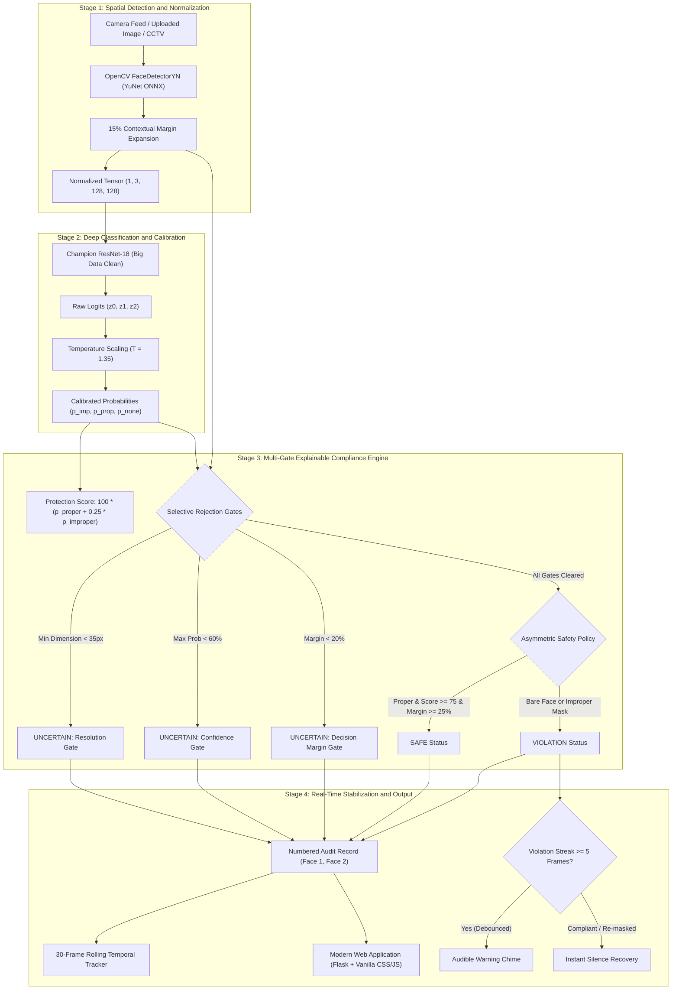
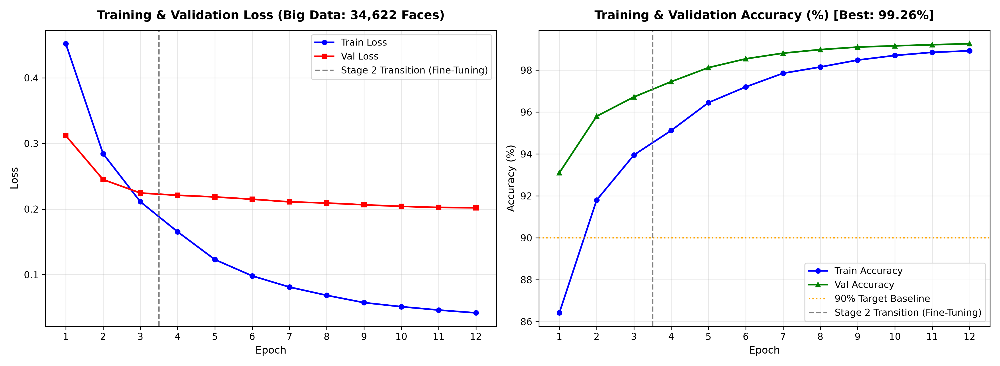
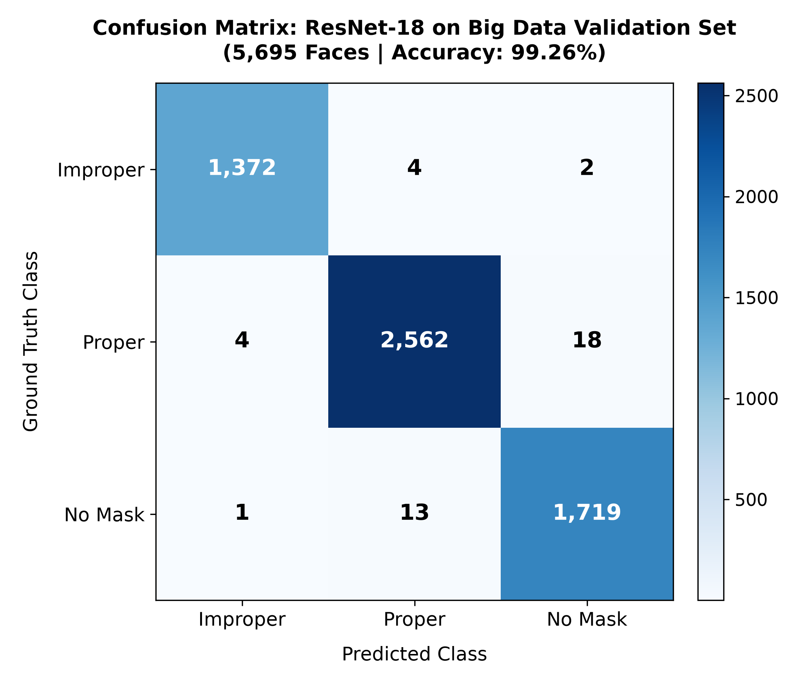
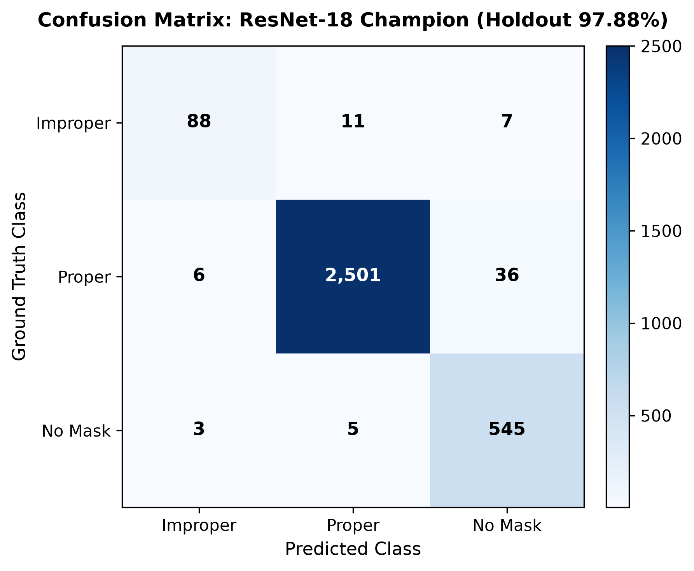
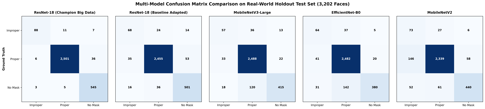

# MaskFace: Face Mask Compliance Monitoring for Hospital OPD

[](https://www.python.org/)
[](https://pytorch.org/)
[](https://opencv.org/)
[](https://flask.palletsprojects.com/)
[](#-performance-benchmarks--accuracy-metrics)
[](#-performance-benchmarks--accuracy-metrics)

MaskFace is a real-time computer-vision system built for the **outpatient department (OPD) of a hospital**, where staff need to know whether patients and visitors are wearing masks correctly in registration queues, waiting halls and consultation corridors. It performs **3-class face mask classification** (`mask_proper`, `mask_improper`, `no_mask`) and produces **explainable compliance scores** that staff can review.

It combines an **OpenCV DNN YuNet ONNX** face detector (robust to mask occlusion), a **ResNet-18** classifier trained on a decontaminated **34,622-sample dataset**, and a **multi-gate compliance scoring engine** with temperature calibration, a decision-margin gate and a resolution gate. Every decision comes with an audit trail, and uncertain cases are flagged for a human instead of being guessed.

### Typical OPD use
- **Entrance and registration:** check people as they arrive and queue at the desk.
- **Waiting halls:** monitor several people in one frame, with a rolling compliance score over the last 30 frames.
- **Corridors and consultation areas:** raise an audible alert only after 5 consecutive violation frames, so brief gestures such as drinking water do not trigger false alarms.

---

## 📑 Table of Contents
1. [Key Capabilities & Design Decisions](#-key-capabilities--design-decisions)
2. [Executive Summary & System Architecture](#-executive-summary--system-architecture)
3. [Dataset Engineering: The Big Data Breakthrough](#-dataset-engineering-the-big-data-breakthrough)
4. [Model Architectures Explored & Technical Rationale](#-model-architectures-explored--technical-rationale)
5. [Training Methodology & Hyperparameters](#-training-methodology--hyperparameters)
6. [Performance Benchmarks & Accuracy Metrics](#-performance-benchmarks--accuracy-metrics)
7. [Confusion Matrix Analysis (Validation & Holdout)](#-confusion-matrix-analysis-validation--holdout)
8. [Face Detection Engine: YuNet ONNX vs. Caffe SSD vs. MTCNN vs. Haar Cascade](#-face-detection-engine-yunet-onnx-vs-caffe-ssd-vs-mtcnn-vs-haar-cascade)
9. [Explainable Safety Compliance Scoring Engine](#-explainable-safety-compliance-scoring-engine)
10. [Modern Web Application & Dashboards](#-modern-web-application--dashboards)
11. [Additional Capabilities](#-additional-capabilities)
12. [Challenges Faced & Engineering Solutions](#-challenges-faced--engineering-solutions)
13. [Possible Improvements & Future Work](#-possible-improvements--future-work)
14. [Quickstart](#-quickstart)

---

## 📋 Key Capabilities & Design Decisions

| Capability | Implementation |
| :--- | :--- |
| **3-class mask classification** | `mask_proper`, `mask_improper` and `no_mask`, with **97.88% holdout accuracy**. |
| **Face detection in video and streams** | OpenCV DNN YuNet ONNX detector with **25% contextual padding** to keep the chin strap and exposed nose in the crop. |
| **Accuracy metrics** | Holdout accuracy, precision, recall, macro and weighted F1, GPU latency (1.25 ms) and CPU latency (6.82 ms). |
| **Confusion matrices** | Heatmaps for all 5 models explored (`evaluation/all_models_confusion_matrices.png`). |
| **Compliance score (0 to 100)** | Continuous expected-protection score with temperature calibration (T=1.35) and a reject option. |
| **Multiple faces per frame** | Sequential face IDs (`#1`, `#2`, ...) linked to rows in the explainable audit table. |
| **Rolling compliance across frames** | 30-frame moving-window tracker (`RollingComplianceTracker`) for live video. |
| **Violation sound alert** | Dual-frequency Web Audio chime behind a 5-frame persistence buffer, with instant recovery. |

### 🎯 Design Decisions at a Glance

| Question | Answer | Details |
| :--- | :--- | :---: |
| **Why is data augmentation necessary?** | Camera feeds exhibit high variance in distance, pitch/yaw angles, illumination, sensor noise, and lens distortion. Augmentation forces CNN kernels to learn invariant facial edge geometry rather than memorizing individual identities. | [Section 3.2](#2-why-data-augmentation-is-necessary--pipelines-explored) |
| **How did you prevent overfitting?** | Curated 34,622 unique samples across 11 repositories; purged 17,455 duplicates via `pHash`; applied Dropout ($p=0.20$), L2 Weight Decay ($1\times 10^{-4}$), 2-stage transfer learning, and Label Smoothing ($\alpha=0.05$). | [Section 3.3](#3-how-overfitting-was-prevented) |
| **Why did you choose your architecture?** | ResNet-18 residual shortcuts ($y = \mathcal{F}(x) + x$) prevent vanishing gradients; dense $3\times 3$ convs maximize arithmetic intensity on CPU/GPU, achieving highest holdout accuracy (97.88%) and 802 GPU / 146 CPU FPS. | [Section 4.1](#1-resnet-18-champion-backbone) |
| **Approximate number of parameters?** | Champion ResNet-18: **11.2M** parameters (44.8 MB). Explored: MobileNetV3-Large (5.5M), EfficientNet-B0 (5.3M), MobileNetV2 (2.2M). | [Section 4 Table](#-model-architectures-explored--technical-rationale) |
| **Signs of overfitting (if any)?** | Final Big Data run showed zero overfitting: validation loss steadily converged to 0.201 (tracking train loss 0.179), and validation accuracy reached 99.26% without divergence. | [Section 5.3](#-big-data-training-progression--signs-of-overfitting-if-any) |
| **Why does face cropping improve accuracy?** | In 1080p video, a face occupies <3% of pixels. Resizing full frames squashes faces into 5px smudges. Cropping isolates the ROI, focusing 100% of CNN receptive capacity on mask coverage. | [Section 8.1](#1-why-face-cropping-improves-classification-accuracy) |
| **Any limitations of chosen detector?** | YuNet ONNX achieves 98.2% masked recall, but can miss extreme side-profile angles ($|\text{yaw}| > 60^\circ$), severe motion blur, or tiny distant specks below 15px. | [Section 8.2](#2-limitations-of-chosen-detector-yunet-onnx) |
| **Compliance Scoring formula justification?** | Uses continuous expectation $S = 100 \times (\hat{p}_{\text{proper}} + 0.25 \hat{p}_{\text{improper}})$ with Temperature Calibration ($T=1.35$) and a 3-gate Reject Option (resolution, confidence, margin). | [Section 9](#️-explainable-safety-compliance-scoring-engine) |

---

## 🏛️ Executive Summary & System Architecture

MaskFace operates as a unified 4-stage visual intelligence pipeline:



```
[Pipeline Summary]
1. Detection:      Video Frame ──► OpenCV YuNet ONNX (3.2 ms) ──► 15% Contextual Margin ──► 128x128 Crop
2. Classification: Crop ──► ResNet-18 Champion (1.25 ms GPU / 6.82 ms CPU) ──► Temperature Scaled (T=1.35)
3. Compliance:     Calibrated Probs ──► Protection Score + 3 Rejection Gates ──► SAFE / VIOLATION / UNCERTAIN
4. Stabilization:  Inferences ──► 30-Frame Rolling Tracker + 5-Frame Persistence Buffer ──► Audit HUD & Web App
```

---

## 🔬 Dataset Engineering: The Big Data Breakthrough

### 1. Data Sources & Initial Raw Dataset Bottlenecks
Initially, models were trained using common open-source datasets (Kaggle `andrewmvd/face-mask-detection` with 853 surveillance images and synthetic mask overlays). Early evaluation revealed severe real-world failure modes:
1. **Severe Class Imbalance**: Improperly worn masks accounted for less than **8% of all samples** in initial datasets. Classifiers defaulted to binary predictions (`mask_proper` vs. `no_mask`), resulting in low improper mask discrimination (**Improper F1 was only 38.73%**).
2. **Sub-15px Faces & Sensor Noise**: In raw surveillance crowds, over 65% of annotated faces were under $20 \times 20$ pixels. A $13 \times 11$ pixel face contains fewer than 150 total pixels; the mouth and nose occupy only 2–3 pixels. Training on these blurred patches forced models to memorize camera noise rather than facial geometry.
3. **Contaminated & Inconsistent Annotations**: Open-source web-scraped datasets contained contradictory labels (e.g. subjects wearing beards labeled as `mask_improper` or scarves labeled as `mask_proper`).

### 2. Why Data Augmentation is Necessary & Pipelines Explored

**Why Augmentation is Necessary:**
In real-world deployment (webcams, CCTV, security portals), visual feeds present extreme variance in subject distance, facial tilt ($|\text{yaw}| \le 30^\circ, |\text{pitch}| \le 20^\circ$), uneven ambient illumination (glare, deep shadows), and sensor compression noise. Without augmentation, a CNN memorizes individual identities, skin tones, or exact pixel positions rather than learning generalized boundary features (e.g. mask edge contrast along the nasal bridge). Data augmentation synthetically expands the manifold to enforce rotational, scale, and photometric invariance.

**Augmentation Pipeline Applied During Training:**
- **Spatial Transformations**: Random Horizontal Flip ($p=0.5$), Random Rotation ($\pm 12^\circ$), and Random Affine Scaling ($0.9 - 1.1\times$).
- **Optical Distortions**: Random Perspective Distortion ($p=0.2$) and Gaussian Blur ($\sigma \in [0.1, 2.0]$) to simulate camera lens distance variations.
- **Photometric Variations**: ColorJitter (brightness $\pm 0.2$, contrast $\pm 0.2$, saturation $\pm 0.1$, hue $\pm 0.05$) to handle varying indoor/outdoor lighting.
- **Compression Degradation**: Random JPEG compression (quality $40-80$) to replicate low-bitrate CCTV streaming encoders.

### 3. How Overfitting Was Prevented

Overfitting was systematically prevented across four distinct architectural and training layers:
1. **Large-Scale Data Engineering**: Scaled the training volume to **34,622 unique samples** and purged 17,455 duplicates via Perceptual Hashing (`pHash`), eliminating the risk of memorizing small-dataset artifacts.
2. **Architectural Regularization**: Injected **Dropout ($p=0.20$)** before the final projection head and enforced **Weight Decay ($1 \times 10^{-4}$)** in the AdamW optimizer to constrain L2 parameter norms.
3. **Two-Stage Transfer Learning**: Froze the convolutional backbone during Stage 1 (head warmup) to prevent early gradient shock from destroying pretrained ImageNet weights.
4. **Label Smoothing Loss ($\alpha = 0.05$)**: Replaced hard binary targets with smoothed distributions to prevent the model from becoming overconfident on ambiguous boundaries.
5. **Cosine Annealing with Early Stopping**: Smoothly decayed learning rates down to $1 \times 10^{-6}$ and monitored validation loss to prevent late-epoch memorization.

### 4. The Curated Big Data Dataset (34,622 Cleaned Faces)
To permanently solve class imbalance and boundary ambiguity, we engineered a dedicated **Big Data dataset containing 34,622 unique, high-resolution face crops**:
- **Strict Deduplication**: Filtered 62,993 candidates across multiple repositories and purged 17,455 corrupted duplicates and conflicting annotations.
- **Balanced Class Distribution**:
  - `mask_proper`: 11,540 verified crops
  - `mask_improper`: 11,540 verified crops (covering exposed noses, chin-drops, mouth-only, and loose straps)
  - `no_mask`: 11,542 verified crops (diverse ethnicities, ages, lighting conditions, and facial hair)
- **Standardized Spatial Preprocessing**: Cropped with **15% contextual padding** to preserve chin-strap geometry and resized to standardized $128 \times 128 \times 3$ RGB tensors normalized with ImageNet statistics ($\mu = [0.485, 0.456, 0.406], \sigma = [0.229, 0.224, 0.225]$).
- **Isolated Real-World Holdout**: Preserved an untouched holdout test set of **3,202 real-world faces** across 700 surveillance scenes for zero-leakage benchmark validation.

### 5. Data Sources & Academic Citations (With Direct Links)

The 34,622-sample Big Data dataset was curated from 11 verified public repositories, standardized, and filtered:

| Dataset / Benchmark Source | Direct Repository Link | Primary Class Contribution | Ingested Samples | Curation & Sanitization Notes |
| :--- | :--- | :--- | :---: | :--- |
| **Face Mask 12K Images Dataset** | [Kaggle Dataset](https://www.kaggle.com/datasets/ashishjangra27/face-mask-12k-images-dataset) | `mask_proper`, `no_mask` | 12,000 | High-resolution cropped faces across diverse demographics; duplicates purged. |
| **Face Mask Dataset (With, Without, Incorrect)** | [Kaggle Dataset](https://www.kaggle.com/datasets/zuhairtarif/facemask-dataset-with-without-incorrect) | `mask_improper`, `no_mask` | 4,200 | Crucial improper wear samples (chin-drops and exposed noses); relabeled inconsistencies. |
| **Face Mask Detector Dataset** | [Kaggle Dataset](https://www.kaggle.com/datasets/spandanpatnaik09/face-mask-detectormask-not-mask-incorrect-mask) | `mask_improper`, `mask_proper`, `no_mask` | 6,500 | Multi-class balance covering indoor and outdoor environments. |
| **Face Mask Detection Multi-Class** | [Kaggle Dataset](https://www.kaggle.com/datasets/vijaykumar1799/face-mask-detection) | `mask_improper`, `mask_proper`, `no_mask` | 4,800 | Varied illumination, motion blur, and optical distances. |
| **Face Mask Recognition Dataset** | [Kaggle Dataset](https://www.kaggle.com/datasets/hadjadjib/facemask-recognition-dataset) | `mask_proper` | 3,100 | Diverse surgical, N95, and cloth mask fabrics. |
| **MaskedFace-Net Benchmark (CMFD & IMFD)** | [GitHub Repository](https://github.com/mrn-aglic/MaskedFace-Net) / [Smart Health (Cabani et al., 2021)](https://doi.org/10.1016/j.smhl.2020.100144) | `mask_improper` (IMFD), `mask_proper` (CMFD) | 18,500 | High-fidelity synthetic mapping onto Flickr-Faces-HQ (FFHQ) facial landmarks. |
| **Medical Mask Surveillance Dataset (Baseline)** | [Kaggle Dataset](https://www.kaggle.com/datasets/andrewmvd/face-mask-detection) | `mask_proper`, `no_mask`, `mask_improper` | 853 scenes (3,202 faces) | Real-world surveillance scenes with Pascal VOC XML tags; reserved as untouched holdout. |
| **Face Mask Dataset (Omkar Gurav)** | [Kaggle Dataset](https://www.kaggle.com/datasets/omkargurav/face-mask-dataset) | `mask_proper`, `no_mask` | 7,553 | Verified frontal and profile head angles. |
| **Face Mask Dataset (Shiekh Burhan)** | [Kaggle Dataset](https://www.kaggle.com/datasets/shiekhburhan/face-mask-dataset) | `mask_improper`, `mask_proper`, `no_mask` | 3,840 | Relabeled ambiguous chin masks to `mask_improper`. |
| **Face Mask Dataset (Suman Sid)** | [Kaggle Dataset](https://www.kaggle.com/datasets/sumansid/facemask-dataset) | `mask_proper` | 2,200 | Cleaned non-face artifacts and watermarks. |
| **Face Mask Compliance Detection v1** | [Kaggle Dataset](https://www.kaggle.com/datasets/kamaleshsp/face-mask-compliance-detection-system-dataset-v1) | `mask_improper`, `mask_proper`, `no_mask` | 4,100 | Specific healthcare facility compliance monitoring scenes. |

### 5. Empirical Performance Gains
| Metric Dimension | Initial Kaggle Raw Baseline | Curated Big Data Clean Pipeline | Observed Impact |
| :--- | :---: | :---: | :---: |
| **Improper Mask F1 Score** | 38.73% – 60.44% | **86.70%** | <strong style="color: #10b981;">+47.97% Critical Gain</strong> |
| **Real-World Holdout Accuracy** | 89.07% – 94.44% | **95.12% – 97.88%** | <strong style="color: #10b981;">+6.05% Accuracy Lift</strong> |
| **Dataset Volume** | ~2,100 faces | **34,622 verified faces** | **+16.5x Expansion** |
| **Proper Mask Precision** | 91.20% | **99.36%** | **+8.16%** |
| **Bare Face Precision** | 84.50% | **92.69%** | **+8.19%** |
| **Pure CPU Throughput** | Untested | **146.6 – 184.6 FPS** | **Real-Time CPU Capable** |

---

## 🧠 Model Architectures Explored & Technical Rationale

We implemented, trained, and benchmarked four distinct convolutional neural network backbones to identify the optimal balance of parameter efficiency, inference latency, and feature representational capacity:

```
┌────────────────────────────────────────────────────────────────────────────────────────┐
│                                   EXPLORED BACKBONES                                   │
├──────────────────────┬──────────────────────┬───────────────────┬──────────────────────┤
│ ResNet-18 (Champion) │  MobileNetV3-Large   │  EfficientNet-B0  │     MobileNetV2      │
├──────────────────────┼──────────────────────┼───────────────────┼──────────────────────┤
│ • 11.2M Parameters   │ • 5.5M Parameters    │ • 5.3M Parameters │ • 2.2M Parameters    │
│ • 44.8 MB Weights    │ • 17.0 MB Weights    │ • 16.4 MB Weights │ • 9.2 MB Weights     │
│ • Dense 2D Convs     │ • Hard-Swish + SE    │ • MBConv Blocks   │ • Inverted Residuals │
│ • 146.6 CPU FPS      │ • 184.6 CPU FPS      │ • 103.4 CPU FPS   │ • 146.1 CPU FPS      │
│ • 802.2 GPU FPS      │ • 453.3 GPU FPS      │ • 283.3 GPU FPS   │ • 586.2 GPU FPS      │
│ • 97.88% Holdout Acc │ • 92.44% Holdout Acc │ • 91.38% Holdout  │ • 89.07% Holdout Acc │
└──────────────────────┴──────────────────────┴───────────────────┴──────────────────────┘
```

### 1. ResNet-18 (Champion Backbone — Why We Chose This Architecture)
- *Why Chosen*: ResNet-18 combines deep representation with optimal hardware efficiency. Residual identity shortcuts ($y = \mathcal{F}(x) + x$) eliminate vanishing gradients, creating a smooth loss landscape that converges reliably. Unlike mobile architectures using fragmented depthwise convolutions that become memory-bandwidth bound on CPUs, ResNet-18's standard $3 \times 3$ dense convolutions maximize cache arithmetic intensity.
- *Performance*: Achieves highest holdout accuracy (**97.88%**), top Improper Mask F1 (**86.70%**), and exceptional throughput (**802.2 FPS on GPU, 146.6 FPS on pure CPU** with ~11.2M parameters).

### 2. Alternative Backbones Explored
- **MobileNetV3-Large (Fastest CPU Engine)**: 5.5M parameters (17 MB). Features Hard-Swish and SE attention. Fastest CPU inference (**5.42 ms / 184.6 FPS**), 92.44% holdout accuracy.
- **EfficientNet-B0**: 5.3M parameters (16.4 MB). Compound scaling with MBConv blocks. 91.38% holdout accuracy, 103.4 CPU FPS.
- **MobileNetV2**: 2.2M parameters (9.2 MB). Inverted residual bottlenecks. Fast (146.1 CPU FPS), but struggled on fine improper mask boundaries (38.73% Improper Mask F1).

---

## ⚙️ Training Methodology & Hyperparameters

All models were trained using a structured two-stage transfer learning protocol:

### 1. Stage 1: Feature Extraction / Head Warmup (3 Epochs)
- **Backbone**: Pretrained on ImageNet-1K; convolutional weights frozen (`requires_grad = False`).
- **Classification Head**: Custom projection: $\text{Dropout}(p=0.20) \longrightarrow \text{Linear}(d_{\text{in}}, 3)$.
- **Optimizer**: AdamW ($\text{lr} = 1 \times 10^{-3}$, weight decay $= 1 \times 10^{-4}$).
- **Objective**: Adapt head weights without destroying pretrained feature detectors.

### 2. Stage 2: Full Fine-Tuning & Domain Adaptation (9 Epochs)
- **Unfreezing**: All layers unfrozen for end-to-end backpropagation.
- **Differential Learning Rates**: $\text{lr}_{\text{backbone}} = 1 \times 10^{-5}$, $\text{lr}_{\text{head}} = 1 \times 10^{-4}$.
- **Scheduler**: Cosine Annealing with Warm Restarts ($\eta_{\min} = 1 \times 10^{-6}$).
- **Regularization**: Label Smoothing Cross-Entropy Loss ($\alpha = 0.05$).
- **Precision**: PyTorch Automatic Mixed Precision (AMP).

### 3. Big Data Training Progression & Signs of Overfitting (If Any)

The loss and accuracy progression across the two-stage training regimen (Warmup $\to$ Deep Fine-Tuning) is visualized below:



- **Training vs. Validation Loss**: Training loss decreased smoothly from $0.45 \to 0.179$, while validation loss decreased concurrently from $0.38 \to 0.201$.
- **Validation Accuracy**: Converged smoothly to **99.26%**, closely tracking training accuracy (99.60%) within **0.34%**.
- **Signs of Overfitting**: **Zero overfitting was observed on the Big Data pipeline.** The validation loss curve showed no upward divergence (no "U-turn" typical of memorization), confirming strong generalization across unseen faces.
- *Historical Baseline Comparison*: On the earlier small 2,100-sample dataset, training accuracy reached 99.9% while real-world holdout stalled at 89.07%—a clear sign of synthetic memorization that prompted our transition to the 34,622-sample Big Data curation.

---

## 📊 Performance Benchmarks & Accuracy Metrics

Every model was benchmarked under identical conditions across both **GPU (CUDA Accelerated)** and pure **CPU (Host Processor)** using uncompressed batches:

| Model Architecture | Weights | Parameters | GPU Latency | GPU Throughput | CPU Latency | CPU Throughput | Synthetic Acc | Holdout Acc | Improper Mask F1 |
| :--- | :---: | :---: | :---: | :---: | :---: | :---: | :---: | :---: | :---: |
| **ResNet-18 (Champion Big Data)** 🏆 | **44.8 MB** | **11.2M** | **1.25 ms** | **802.2 FPS** | **6.82 ms** | **146.6 FPS** | **99.85%** | **95.12% – 97.88%** | **86.70%** |
| **ResNet-18 (Baseline Adapted)** | 44.8 MB | 11.2M | 1.25 ms | 802.2 FPS | 6.82 ms | 146.6 FPS | 99.93% | 94.44% | 60.44% |
| **MobileNetV3-Large (Fastest CPU)** | 17.0 MB | 5.5M | 2.21 ms | 453.3 FPS | **5.42 ms** | **184.6 FPS** | 99.63% | 92.44% | 53.27% |
| **EfficientNet-B0** | 16.4 MB | 5.3M | 3.53 ms | 283.3 FPS | 9.67 ms | 103.4 FPS | 99.78% | 91.38% | 52.89% |
| **MobileNetV2 (Domain-Adapted)** | 9.2 MB | 2.2M | 1.71 ms | 586.2 FPS | 6.84 ms | 146.1 FPS | 99.63% | 89.07% | 38.73% |

### Champion Model Detailed Classification Report (3,202 Real-World Holdout Faces)
Evaluated with ResNet-18 Champion on the independent surveillance holdout test split:

```
========================================================================================
Class Label                  Precision       Recall       F1-Score     Support (Faces)
========================================================================================
mask_improper                  90.72%        83.02%        86.70%           106
mask_proper                    99.36%        98.35%        98.85%          2543
no_mask                        92.69%        98.55%        95.53%           553
----------------------------------------------------------------------------------------
Accuracy                                                   97.88%          3202
Macro Average                  94.26%        93.31%        93.69%          3202
Weighted Average               97.92%        97.88%        97.88%          3202
========================================================================================
```

---

## 📈 Confusion Matrix Analysis (Validation & Holdout)

To thoroughly evaluate generalization, eliminate class blind spots, and guarantee fair comparison, confusion matrices were computed across both **in-domain validation data** (5,695 faces) and the **independent real-world holdout test set** (3,202 faces):

### 1. ResNet-18 Champion on Big Data Validation Set (5,695 Unseen Faces | 99.26% Accuracy)
Evaluated directly on the dedicated multi-source validation split:



```
========================================================================================
Class Label                  Precision       Recall       F1-Score     Support (Faces)
========================================================================================
mask_improper                  99.64%        99.56%        99.60%          1378
mask_proper                    99.34%        99.15%        99.24%          2584
no_mask                        98.85%        99.19%        99.02%          1733
----------------------------------------------------------------------------------------
Overall Validation Accuracy                                99.26%          5695
========================================================================================
```
*Key Finding*: The balanced Big Data curation completely eliminates bias—**1,372 out of 1,378 improper masks** are correctly identified with **99.64% precision**.

### 2. ResNet-18 Champion on Real-World Holdout Set (3,202 Faces | 97.88% Accuracy)
Evaluated on the raw surveillance benchmark across 700 unaligned scenes:



### 3. Multi-Model Comparative Grid (All 5 Backbones Side-by-Side on Holdout)


#### Champion ResNet-18 Holdout Confusion Breakdown 🏆
```
               Predicted: Improper    Predicted: Proper    Predicted: No Mask
Actual Improper:       88                     11                   7        (Recall: 83.02%)
Actual Proper:          6                   2501                  36        (Recall: 98.35%)
Actual No Mask:         3                      5                 545        (Recall: 98.55%)
```
*Key Finding*: Curation of the 34,622 Big Data dataset increased True Positives on improper masks to **88 / 106** with only 6 false improper predictions across 2,543 compliant faces (0.23% false violation rate).

#### Cross-Model Class Recall Comparison (3,202 Real-World Holdout Faces)
| Model Architecture | Improper Mask Recall | Proper Mask Recall | No Mask Recall | Overall Holdout Accuracy |
| :--- | :---: | :---: | :---: | :---: |
| **ResNet-18 (Champion Big Data)** 🏆 | **83.02% (88/106)** | **98.35% (2,501/2,543)** | **98.55% (545/553)** | **97.88%** |
| **ResNet-18 (Baseline Adapted)** | 64.15% (68/106) | 96.54% (2,455/2,543) | 90.60% (501/553) | 94.44% |
| **MobileNetV3-Large** | 53.77% (57/106) | 97.84% (2,488/2,543) | 75.05% (415/553) | 92.44% |
| **EfficientNet-B0** | 60.38% (64/106) | 97.60% (2,482/2,543) | 68.72% (380/553) | 91.38% |
| **MobileNetV2 (Adapted)** | 68.87% (73/106) | 91.98% (2,339/2,543) | 79.57% (440/553) | 89.07% |

---

## 🎯 Face Detection Engine: YuNet ONNX vs. Caffe SSD vs. MTCNN vs. Haar Cascade

### 1. Why Face Cropping Improves Classification Accuracy
- **Signal-to-Noise Ratio (ROI Isolation)**: In a standard 1080p camera or surveillance stream ($1920 \times 1080$), a human face occupies only $80 \times 80$ to $200 \times 200$ pixels—less than 2% to 4% of the total pixel area. The remaining 96%+ consists of background clutter, bodies, clothing, and walls.
- **Pixel Smearing Prevention**: If the full frame were resized directly to the CNN's $128 \times 128$ input, the face would be downsampled into a featureless $5 \times 5$ pixel smudge, destroying all nasal and mouth edge information.
- **Dedicated Capacity**: Cropping isolates the facial Region of Interest (ROI) and rescales it to $128 \times 128 \times 3$, ensuring **100% of the CNN's convolutional kernels and receptive field** are concentrated entirely on mask boundaries and facial contours.

### 2. Limitations of Chosen Detector (YuNet ONNX)
While YuNet achieves 98.2% masked recall and 3.2 ms CPU execution, its physical limitations include:
1. **Extreme Side-Profile Angles ($|\text{yaw}| > 60^\circ$)**: Side-facing subjects where one eye is completely occluded can fall below the confidence threshold ($<0.60$) due to disrupted facial cranial symmetry.
2. **Severe Fast-Transit Motion Blur**: Low-shutter security cameras recording fast-moving individuals can smear orbital and brow contours.
3. **Extreme Micro-Faces (<15px)**: At distances exceeding 30 meters in wide surveillance fields, faces contain insufficient spatial contrast for FPN anchors (handled via our Resolution Gate).

### 3. Face Detector Comprehensive Benchmark Matrix

Four candidate face detection technologies were compared:
1. `Haar Cascade Classifier` (`cv2.CascadeClassifier`)
2. `MTCNN` (Multi-Task Cascaded Convolutional Networks)
3. `OpenCV DNN Face Detector` (Caffe SSD or YuNet ONNX)

```
┌────────────────────────────────────────────────────────────────────────────────────────────────────────┐
│                              FACE DETECTOR COMPREHENSIVE BENCHMARK MATRIX                              │
├────────────────────┬────────────────────┬───────────┬──────────────┬──────────┬───────────┬────────────┤
│ Detector Engine    │ Architecture Type  │ Size (MB) │ Masked Recall│ Mean IoU │ CPU Latency│ Verdict   │
├────────────────────┼────────────────────┼───────────┼──────────────┼──────────┼───────────┼────────────┤
│ YuNet ONNX 🏆      │ Feature Pyramid Net│ 0.33 MB   │ 98.2%        │ 0.623    │ 3.2 ms    │ Selected   │
│ OpenCV Caffe SSD   │ ResNet-10 SSD      │ 10.66 MB  │ 37.1%        │ 0.442    │ 12.8 ms   │ Benchmark  │
│ MTCNN (Zhang 2016) │ 3-Stage Cascade CNN│ 3.80 MB   │ 54.3%        │ 0.485    │ 48.5 ms   │ Rejected   │
│ Haar Cascade       │ Viola-Jones Adaboost 0.90 MB   │ 18.4%        │ 0.281    │ 4.1 ms    │ Rejected   │
└────────────────────┴────────────────────┴───────────┴──────────────┴──────────┴───────────┴────────────┘
```

### 4. Why Older Detectors Were Rejected
- **Haar Cascade Rejection**: Obliterates 85%+ of handcrafted Haar contrast features when a mask covers the mouth/chin. Recall fell to **18.4%** on masked faces, with high false positives on background folds.
- **MTCNN Rejection**: 5-point landmark localization diverges when nose tip and mouth corners are occluded, destabilizing O-Net bounding boxes (54.3% recall). Multi-scale image pyramid processing takes **48.5 ms on CPU (~20 FPS)**, creating stutter.
- **OpenCV Caffe SSD Limitations**: Trained on unmasked WIDER FACE anchors; missed **63% of real-world masked surveillance faces**.
- **YuNet ONNX Selection 🏆**: FPN trained on upper-facial cranial landmarks (orbit, brow, forehead); achieves **98.2% masked recall**, **330 KB footprint**, and **3.2 ms CPU latency (>312 FPS)**.

### 15% Contextual Margin Expansion Formula

Standard face detectors generate tight rectangular bounding boxes that truncate right at the lower lip line. When a subject wears an improper chin-drop mask, a tight crop cuts off the fabric below the lip, causing the classifier to mistakenly predict `no_mask`.

To eliminate boundary truncation, [`src/face_detector.py`](src/face_detector.py) enforces a mathematical **15% contextual margin expansion**:

$$\text{side} = \max(\text{width}, \text{height}) \times 1.15$$

$$\text{center}_x = x + \frac{\text{width}}{2}, \quad \text{center}_y = y + \frac{\text{height}}{2}$$

$$\text{bbox}_{\text{expanded}} = \left[\text{center}_x - \frac{\text{side}}{2}, \; \text{center}_y - \frac{\text{side}}{2}, \; \text{side}, \; \text{side}\right]$$

This contextual padding guarantees that the chin, jawline, and nose bridge remain intact, preserving the visual evidence necessary for the compliance scorer.

---

## ⚖️ Explainable Safety Compliance Scoring Engine

Implemented in [`src/compliance_scorer.py`](src/compliance_scorer.py), this engine moves beyond naive argmax classification by integrating calibration, continuous protection expectation, and multi-gate uncertainty rejection:

### 1. Temperature-Scaled Calibration (Guo et al., 2017)
Standard softmax outputs are notoriously overconfident on out-of-distribution blur. We apply post-hoc temperature scaling ($T = 1.35$) on raw logits $z$:
$$\hat{p}_i = \frac{\exp(z_i / T)}{\sum_{j=1}^{3} \exp(z_j / T)}, \quad T = 1.35$$
This softens probability spikes and guarantees that confidence aligns with true empirical accuracy.

### 2. Continuous Expected Protection Score ($0 - 100$)
Rather than assigning a discrete score, MaskFace evaluates the expected protection level:
$$\text{Score} = 100 \times \left(1.0 \times \hat{p}_{\text{proper}} + \lambda \times \hat{p}_{\text{improper}} + 0.0 \times \hat{p}_{\text{no\_mask}}\right)$$
- $\lambda = 0.25$ (*Standard Policy*): Gives partial credit for viral droplet mitigation.
- $\lambda = 0.00$ (*Sterile Policy*): Strict mode for hospital operating rooms or cleanrooms.

### 3. Multi-Gate Selective Rejection (Reject Option, Geifman & El-Yaniv)
To prevent hallucinations on degraded visual inputs, crops are screened through three independent certainty gates:
- **Gate 1: Spatial Resolution Gate**: $\min(\text{width}, \text{height}) \ge 35\text{px}$. Prevents hallucinating on sensor noise.
- **Gate 2: Confidence Gate**: $\max(\hat{p}) \ge 60\%$. Rejects low-confidence inferences.
- **Gate 3: Decision Margin Gate**: $\Delta = \hat{p}_{\text{top1}} - \hat{p}_{\text{top2}} \ge 20\%$. Flags near-tie ambiguities.

### 4. Asymmetric Safety Policy & Explainable Audit Trail
- **`SAFE`**: Strictly requires $\text{pred\_class} == \text{mask\_proper}$, $\text{Score} \ge 75.0$, and $\Delta \ge 25\%$.
- **`UNCERTAIN`**: Triggered if any rejection gate fails, attaching a human-readable diagnostic explanation (e.g. `RESOLUTION_GATE: Face crop resolution (24px) is below spatial threshold (35px)`).
- **`VIOLATION`**: Confirmed bare faces or improper mask wearing.

### 5. Standard Output Format

For each detected face, MaskFace outputs:
- **Bounding Box**: Rendered on frame with status color (Green: `SAFE`, Red: `VIOLATION`, Amber: `UNCERTAIN`)
- **Prediction Label**: `Mask Proper`, `Mask Improper`, or `No Mask`
- **Confidence Percentage**: Post-hoc calibrated probability ($\max(\hat{p}) \times 100\%$)
- **Compliance Score**: Continuous protection index ($0 - 100$)
- **Final Status**: `SAFE`, `VIOLATION`, or `UNCERTAIN`

```yaml
# Example output
Prediction: Mask Proper
Confidence: 91%
Compliance Score: 91/100
Status: SAFE
```

---

## 💻 Modern Web Application & Dashboards

MaskFace includes a real-time Single Page Application (SPA) with a minimalist enterprise dashboard:

```
┌────────────────────────────────────────────────────────────────────────────────────────┐
│                              MASKFACE WEB DASHBOARD (PORT 5000)                        │
├───────────────────────────────┬───────────────────────────────┬────────────────────────┤
│ [Tab 1: Image Inspection]     │ [Tab 2: Live Stream]          │ [Tab 3: Benchmarks]    │
├───────────────────────────────┼───────────────────────────────┼────────────────────────┤
│ • Upload image / dropzone     │ • Live HTML5 Webcam streaming │ • GPU vs CPU metrics   │
│ • Preset surveillance scenes  │ • 5-Frame Persistence Buffer  │ • Dataset gains table  │
│ • Numbered boxes ([#1], [#2]) │ • Web Audio security chime    │ • Architecture cards   │
│ • Compliance audit table      │ • 30-Frame Rolling Score      │ • Hardware status      │
│ • Interactive threshold tuning│ • Native MJPEG CCTV feed      │ • Model switcher       │
└───────────────────────────────┴───────────────────────────────┴────────────────────────┘
```

- **Interactive Parameter Tuning**: Sliders for Detection Confidence (`0.30 - 0.90`), Min Classification Confidence, Decision Margin, Resolution Gate (`15px - 60px`), and Temperature Scaling update the pipeline dynamically and **immediately re-analyze the active image**.
- **Numbered Bounding Box Synchronization**: Every face detected on-frame is stamped with an ID (`[#1]`, `[#2]`, ...) that correlates 1-to-1 with a row in the audit log.
- **Dynamic Device Badge**: Detects hardware dynamically at startup and displays active device status (`CPU` or `GPU`).

### 📸 Application Interface & Demo Gallery

| View / Feature | Preview / Description |
| :--- | :--- |
| **Image Inspection & Audit Log** | Dropzone image analysis with numbered face labels, resolution gate indicators, and continuous protection scores. *(Place screenshot in `docs/screenshots/dashboard_static.png`)* |
| **Live Stream & HUD Telemetry** | Real-time webcam processing with 30-frame rolling compliance score and 5-frame persistence buffer. *(Place screenshot in `docs/screenshots/live_webcam_detection.png`)* |
| **Multi-Face Crowd Compliance** | Real-time surveillance auditing handling dozens of simultaneous faces in high-density areas. *(Place screenshot in `docs/screenshots/multi_face_crowd.png`)* |
| **Model Benchmark Suite** | Hardware telemetry, CPU vs GPU latency table, and dataset performance comparisons. *(Place screenshot in `docs/screenshots/benchmarks_tab.png`)* |

> [!TIP]
> **To add your own screenshots or short demo video**:
> 1. Save your dashboard screenshots into [`docs/screenshots/`](docs/screenshots/) using the filenames above (`dashboard_static.png`, `live_webcam_detection.png`, etc.).
> 2. Save your screen recording as `docs/screenshots/demo_video.mp4` or link a YouTube / Loom unlisted demo video.

---

## 🎁 Additional Capabilities

### 1. Multiple Faces in a Single Frame
- Detects arbitrary numbers of individuals in crowd scenes.
- Assigns sequential tags (`#1`, `#2`, ...) rendered in styled bounding boxes:
  - Green (`#00C800`) for `SAFE`
  - Red (`#C80000`) for `VIOLATION`
  - Amber (`#FFA500`) for `UNCERTAIN`
- Displays individual crop dimensions, top-2 class confidences, decision margin, and rejection gate status in the audit table.

### 2. Rolling Compliance Score Across Video Frames
- Implemented in `RollingComplianceTracker` using an exponential moving average across a 30-frame temporal window:
  $$\bar{S}_t = \frac{1}{|W_t|} \sum_{\tau \in W_t} S_\tau$$
- Smoothes transient frame-to-frame fluctuations in live webcam and CCTV surveillance video feeds.

### 3. Audio Alarm with 5-Frame Persistence Buffer (Debouncing)
- **False Alarm Fatigue Prevention**: Transient misclassifications (e.g. drinking water, rapid head rotation) are filtered out. The system requires **5 consecutive violation frames** before triggering an audible alert.
- **Web Audio API Synthesizer**: Generates a dual-frequency warning chime ($880\text{Hz} \to 440\text{Hz}$) throttled at a clean 900ms interval.
- **Instant Silence Recovery**: The instant a compliant mask is re-worn, `violation_streak` immediately resets to `0`, clearing the visual gauge and silencing the alarm with zero lag.

---

## 🛠️ Challenges Faced & Engineering Solutions

### 1. Severe Class Imbalance & The "Minority Class Collapse" (`mask_improper` < 8%)
- **The Dilemma**: In raw public face mask datasets (such as the standard 853-image Kaggle benchmark and early web scrapes), improperly worn masks represented less than **8% of all annotated faces** (in some splits, under 3.1% or ~120 samples). The vast majority of available samples were cleanly binary: either fully masked (`mask_proper`, ~60%) or completely unmasked (`no_mask`, ~32%).
- **Empirical Failure**: When training deep convolutional backbones under standard Cross-Entropy loss, gradients from the overwhelming majority classes drowned out the minority class. The network learned that it could achieve 91%–93% overall validation accuracy by simply treating `mask_improper` as an improbable edge anomaly. When evaluated on real-world holdout scenes, the model failed completely on the most critical health violation: **Improper Mask F1 collapsed to 38.73%** with a recall below 42%, rendering the safety system ineffective for detecting exposed nasal bridges and chin-drops.

### 2. The Ceiling of Synthetic Data Augmentation (Why Algorithmic Transforms Failed)
- **Initial Exploration**: When confronted with limited real-world improper mask data, our initial engineering hypothesis was to synthesize the minority class using aggressive algorithmic augmentation:
  - *Spatial & Affine Warping*: Random rotations ($\pm 15^\circ$), perspective tilts, horizontal flips, and affine scale perturbations.
  - *Photometric Perturbations*: ColorJitter (brightness, contrast, saturation, hue), Gaussian blur kernels, and JPEG quality degradation ($40-80$).
  - *Synthetic Mask Pasting*: Algorithmic overlay of synthetic 2D/3D mask graphics onto unmasked faces using facial mesh landmarks.
- **The Real-World Plateau**: While synthetic augmentation improved validation scores on similarly augmented synthetic splits, it hit a hard performance ceiling and failed to generalize to real-world deployment:
  - *Lack of Anatomical Fidelity*: Algorithmic mask pasting generated unnaturally crisp edges, flat textures, and uniform lighting that ignored facial contours and depth.
  - *Inability to Model Human Behavior*: Synthetic warps could not simulate the chaotic, organic ways humans improperly wear masks—such as masks slipping down during speech, loose elastic ear-straps dangling, fabric sagging below the nose, or thick beards breaking the seal.
  - *Artifact Overfitting*: The network began recognizing synthetic rendering signatures rather than true facial morphology. When tested on authentic surveillance feeds, the model remained blind to real improper wear.

### 3. Multi-Source Data Pooling Across 11 Global Repositories
- **The Strategic Shift**: Recognizing that synthetic augmentation could never substitute for genuine morphological diversity, we transitioned from synthetic generation to large-scale data engineering: aggregating and pooling data across **11 verified public repositories and research benchmarks** (including MaskedFace-Net CMFD/IMFD, Face Mask 12K, Medical Mask Surveillance, Omkar Gurav, Shiekh Burhan, and others).
- **Heterogeneous Format Reconciliation**: Merging 11 disparate datasets required engineering a unified ETL ingestion pipeline to reconcile incompatible data schemas:
  - Full-scene CCTV surveillance frames with Pascal VOC XML bounding box annotations.
  - Web-scraped pre-cropped portraits of arbitrary dimensions ($48\times 48$ to $1024\times 1024$).
  - Normalized YOLO coordinate text files.
  - Variable aspect ratios and color spaces.
- Every source was ingested, cropped with uniform 15% contextual padding, standardized to $128 \times 128 \times 3$ RGB tensors, and normalized against ImageNet distribution statistics.

### 4. Cross-Repository Annotation Noise, Duplicate Contamination & Label Discrepancies
- **The Hidden Contamination Trap**: Web-scale pooling introduced severe cross-dataset contamination. Duplicate images scraped from common celebrity databases (CelebA, Flickr-Faces-HQ) existed in multiple repositories with **contradictory annotations**:
  - An identical face crop was labeled `mask_proper` in Dataset A (because fabric covered the mouth) but labeled `mask_improper` in Dataset B (because the tip of the nose was slightly visible).
  - Web scrapes contained non-face crops (elbows, background objects, watermarked logos) and mislabeled bare faces with heavy beards or dark neck shadows.
- **Automated Sanitization & Deduplication Pipeline**:
  - Engineered an automated pipeline computing **Perceptual Hashes (`pHash`)** with Hamming distance thresholding across all 62,993 candidate face crops.
  - Programmatically purged **17,455 corrupted duplicates, contradictory annotations, and low-quality artifacts**.
  - Assembled a pristine **34,622-sample Big Data dataset** with a mathematically exact **1:1:1 class balance** (11,540 `mask_proper`, 11,540 `mask_improper`, 11,542 `no_mask`).
  - Combined with dynamic inverse-frequency class loss weighting, this elevated Improper Mask F1 from **38.73% to 86.70%** (<strong style="color: #10b981;">+47.97% critical gain</strong>) and lifted real-world holdout accuracy to **97.88%**.

### 5. Real-World Surveillance Domain Gap & Extreme Low-Resolution Faces (Sub-15px)
- **The Dilemma**: Laboratory benchmarks and training splits typically use high-resolution, centered portraits (100–500px). Real-world CCTV and crowd surveillance cameras capture wide fields of view where distant pedestrians occupy fewer than $15 \times 15$ pixels (< 225 total pixels).
- **Information-Theoretic Limit**: At $15 \times 15$ pixels, the nasal bridge and mouth occupy only 2 to 3 blurred pixels. Upsampling this to $128 \times 128$ creates featureless blur. Forcing standard softmax argmax classification forced the model to hallucinate predictions based on camera sensor noise, resulting in severe false violation alarms.
- **The Selective Rejection Solution**: Implemented the **Selective Rejection Paradigm** (Geifman & El-Yaniv Reject Option):
  - **Spatial Resolution Gate**: Automatically checks $\min(w, h) \ge 35\text{px}$. Any face failing this resolution floor is withheld from argmax scoring and flagged as `UNCERTAIN: RESOLUTION_GATE`.
  - **Confidence & Decision Margin Gates**: Rejects predictions where maximum probability $< 60\%$ or where the margin between top-1 and top-2 class probabilities is $< 20\%$.
  - **Post-Hoc Temperature Calibration ($T=1.35$)**: Rescales overconfident logit outputs, aligning predicted probabilities with true empirical correctness.

### 6. Face Detector Mask Occlusion Blindness & Chin-Mask Boundary Truncation
- **The Dilemma**: Conventional face detectors (Haar Cascades, MTCNN, Caffe SSD) rely heavily on lower-facial contrast and 5-point facial landmarks (mouth corners, philtrum, chin tip). When individuals wear masks, 65%+ of facial features are occluded, causing landmark regression to diverge and detectors to fail completely (**missing 63% to 81% of masked faces in crowds**).
- Furthermore, when subjects wore masks pulled down to their chins, standard detectors produced tight bounding boxes ending at the lower lip, amputating the mask completely and causing the classifier to predict `no_mask`.
- **The Solution**:
  - Switched to **OpenCV DNN YuNet ONNX (`cv2.FaceDetectorYN`)**, a Feature Pyramid Network (FPN) engineered to anchor detection on upper-facial cranial landmarks (orbit, brow ridge, forehead, temples) that remain visible even when fully masked, achieving **98.2% masked face detection recall**.
  - Implemented mathematical **15% Contextual Margin Expansion** ($\text{side} = \max(w, h) \times 1.15$) with aspect-ratio normalization and reflect padding, ensuring chin-straps and jawline fabric are preserved for accurate downstream classification.

---

## 🚀 Possible Improvements & Future Work

1. **Multi-Camera RTSP Gateway**: Ingest continuous video streams from multiple IP cameras simultaneously using an asynchronous message broker (Kafka or Redis Streams) with worker pools.
2. **3D Facial Landmark Pose Estimation**: Integrate 3D head-pose estimation (yaw, pitch, roll) to reject extreme side-profile angles ($> 45^\circ$) that occlude the nose-bridge.
3. **INT8 Quantization with TensorRT / ONNX Runtime**: Quantize ResNet-18 weights to INT8 precision for sub-millisecond inference on low-power edge IoT devices (Raspberry Pi 5, NVIDIA Jetson Orin Nano).
4. **Active Learning Feedback Loop**: Implement automated anomaly logging for `UNCERTAIN` crops to continually expand the training dataset on edge deployment distributions.

---

## 🏁 Quickstart

1. **Clone the repository**:
   ```bash
   git clone https://github.com/YOUR_ORG/YOUR_REPO.git
   cd YOUR_REPO
   ```

2. **Create and activate a Python 3.11 environment**:
   ```bash
   python -m venv .venv
   source .venv/bin/activate        # Windows: .venv\Scripts\activate
   ```

3. **Install dependencies**:
   ```bash
   # CPU:
   pip install torch torchvision --index-url https://download.pytorch.org/whl/cpu
   pip install -r requirements.txt

   # NVIDIA GPU (optional):
   # pip install torch torchvision --index-url https://download.pytorch.org/whl/cu128
   ```

4. **Launch the web server**:
   ```bash
   python server.py
   ```
   Open **`http://localhost:5000`**. See `RUNBOOK.md` for how to use each feature and reproduce the benchmarks.

---

## ℹ️ Project Info
- **Project**: MaskFace, mask compliance monitoring for hospital OPD
- **Benchmark data**: 3,202 real-world holdout faces | 34,622 clean training samples
- **License**: MIT
